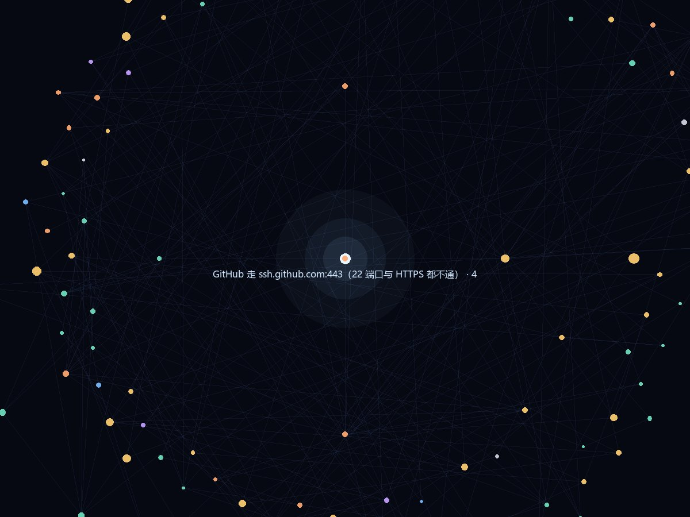
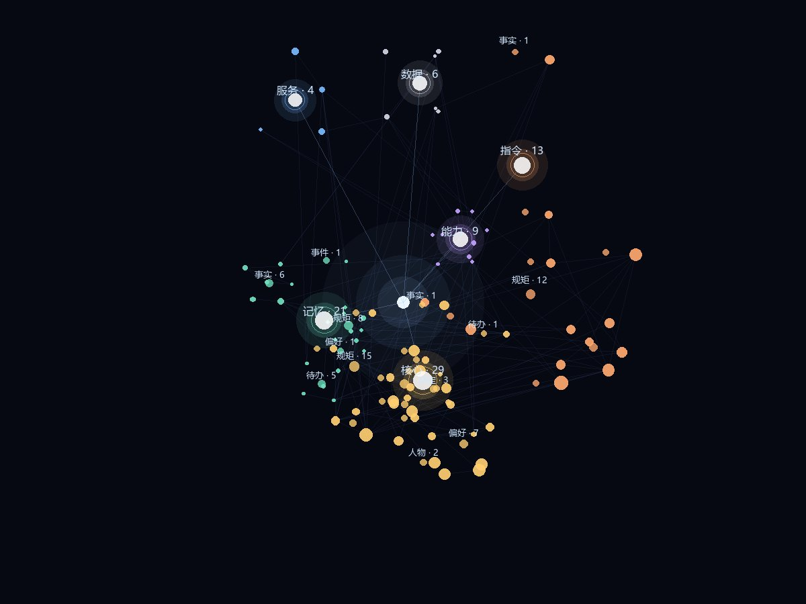

# 记忆星云 · dsh-memory-nebula

给 [DeepSeek Harness](https://github.com/deepseek-ai) 桌面端用的长期记忆插件。

**v0.2.1** · MIT · 零依赖 · 纯本地 · 不调模型 · 不联网



不是记事本。它会**自己记事、自己按话题想起来**——每轮对话前，拿你刚说的那句话去记忆库里翻，只把真正相关的那几条塞回上下文。

- 平时它不说话；翻不到的时候它会说「这一刻没有相关的」，不占思考
- 记忆随时间变淡（45 天半衰期），常被想起来的部分更牢
- 侧栏有一张能转、能点、能钻进去的星云图
- **纯本地、零依赖、不调任何模型或 API**：只有一个 `graph.json`

---

## 为什么需要它

上下文窗口是有限的。聊得越久，模型越只看得见最近几屏，人会「忘事」。

把值得长期记住的东西（偏好、决定、教训、人物、待办）抽成独立节点存下来，每轮只挑跟当前话题相关的几条送回上下文——等于给模型装了一层可检索的长期记忆，而不是把所有历史都堆进 prompt。

实测：一百多条记忆、每轮只注入 5 条（约 500 字），上下文占用基本恒定，跟库有多大没关系。

---

## 检索是怎么工作的

这是整个插件最要紧的部分。一次 `memory_search` 走这条流水线：

**1. 归一化** — 全角转半角、统一大小写和空白。`Ｂ站` / `B 站` / `b站` 落到同一个词上。

**2. 粗分词** — 中文没有天然词界，这里用 2-gram（相邻两字），再做两轮清洗：
- 丢掉停用词（`什么`、`怎么`、`一下`……）
- 丢掉**含虚词的 2-gram**（`人的`、`是的`、`在了`）——这一步很关键，不然「主人的 GitHub 账号」会因为命中 `人的` 而排到「主人是音乐表演学生」前面

英文和数字按完整词切，不走 2-gram。

**3. IDF 加权** — 越罕见的词越说明问题。`插件` 出现在几十条记忆里，权重就低；`pnpm` 只出现在两条里，权重就高。

字段也有层级差：标题命中 ×6，标签 ×4，正文 ×1.5。

**4. 倒排索引** — 词 → 出现在哪些记忆里。查询时先收窄候选，不做全表扫描。库大了也不会卡。

**5. 共现学习** — 插件从**已有的记忆**里学：哪些词老是出现在同一条记忆的标题或标签里（`b站` 和 `bilibili`、`桌面端` 和 `启动`）。查询时把这些词按 0.45 权重补进来。库越大，这层越准。**不依赖模型，纯统计。**

**6. 顺连线联想** — 字面命中之后，顺着记忆之间的连线往外扩一跳。这是「想起 A 顺带想起 B」。

**7. 相对门槛** — 不是「凑够 5 条」，而是：比第一名低 58% 以上的直接丢掉。宁可只返回 2 条，也不拿不相关的凑数。

最终打分：

```
score = 字面(归一化) × 1.0
      + 联想 × 0.5
      + 可及性 × 0.22        ← 权重 × 活跃度 × 钉住，只做微调，不主导
      + 新鲜度 × 0.1
```

可及性的权重刻意压得很低。压高了会出现这种糟心事：一条钉住的旧记忆，靠「权重高」硬挤掉真正对题的那条。

### 所以它不用 embedding

向量检索确实更强，但它要模型、要 API、要 key、要钱、要联网——这不是一个插件该有的样子。

上面这套做法在「记忆条数以百计、查询是你自己的日常问法」这个规模上够用，而且是**确定性的**：同样的库、同样的查询，结果永远一样，能调试。

---

## 记忆是怎么活的

每条记忆有四个数：

| 字段 | 含义 |
| --- | --- |
| `weight` | 重要程度，0~1，写的时候给定 |
| `act` | 激活强度，被想起来就上升，之后按小时级半衰期衰减 |
| `strength` | 记忆强度，每想起一次涨一点，衰减更慢 |
| `hits` | 被想起过多少次 |

三个月没被想起来的，会自己沉到看不见的地方（不删，还在图上）。钉住的（`pinned`）不吃衰减。

这层是照着人脑的样子做的：常用路径越走越宽，冷门路径慢慢长草。

---

## 七个工具

| 工具 | 干什么 |
| --- | --- |
| `memory_save` | 记一条。自动去重、自动和相似记忆连线；`closes` 顺手收掉一条待办 |
| `memory_search` | 检索。返回 `belongsTo`（属于哪层哪类）和 `links`（连着的几条） |
| `memory_get` | 按 id 取全文，连带邻居 |
| `memory_link` | 手动连两条 |
| `memory_forget` | 删掉一条（连同连线） |
| `memory_pin` | 钉住 / 取消钉住 |
| `memory_stats` | 总量、连线、孤立、各层各类分布 |

自动连线只在**标题语义**或**标签**重合时才连。正文共现不算——正文里的功能词（验证、用于、自动）跨主题必定撞车，按它连线会越长越乱。

---

## 界面

侧栏一张可交互的星云，五种看法：




- **小银河** — 中心核 + 星系臂，六个大类各是一颗行星，自己转
- **星云** — 3D 力导向。**层级按内容自动递归**：某一团太大且还能分类，就自己再往下分一层，不固定层数
- **聚类** — 同类型抱团
- **时间轴** — 一行一层，从左往右是时间
- **列表** — 分组、折叠、按层按类看

交互：点类别自动聚焦（以那个点为新核心重排），拖拽旋转带惯性，悬停出卡片，右侧详情能看到权重/活力/想起次数/连线，以及同层相似、同标签的邻居。

左栏：分层开关、类型开关、状态与排序、节点大小与标签密度、概览统计、分层占比。右栏：详情 + 统计 + 最近更新。

---

## 安装

要求 DSH 桌面端。

```bash
dsh plugin --profile desktop add link:/path/to/dsh-memory-net
```

或放进 `~/.dsh/plugins/`，用插件管理器安装。

装完重启 DSH。协议、面板、工具都是自动注册的。

---

## 数据

全部在 `~/.dsh/memory-net/graph.json`：

```json
{
  "version": 1,
  "nodes": [{ "id": "m_xxx", "title": "...", "body": "...", "layer": "core", "kind": "rule",
              "tags": ["坑"], "weight": 0.8, "pinned": true, "status": "",
              "createdAt": 0, "updatedAt": 0, "hits": 0, "act": 0, "strength": 1 }],
  "edges": [{ "from": "m_a", "to": "m_b", "kind": "related", "weight": 0.6 }]
}
```

写入是原子的（tmp → rename），写失败不脏盘。删掉这个文件等于清空记忆。

---

## 结构

```
lib/index.js     host：7 个工具、每轮注入、/api/dsh-memory-nebula 路由
lib/store.js     存储、检索打分、连线、衰减、注入文本
lib/client.js    侧栏面板与画布（React + Canvas 2D，无第三方依赖）
cordis.patch.yml 挂载点
```

零运行时依赖。

---

## 路线图

- [ ] 检索结果的「为什么想起它」可视化到画布上
- [ ] 记忆合并（同一件事写了两遍，合并成一条）
- [ ] 导出 / 导入（迁移到另一台机器）
- [ ] 按时间回溯（看三个月前的自己知道什么）

## 检索的可解释性

搜索框里的词不是简单过滤，而是走完整的三通路检索，并且**把理由写在每一条上**：

- 列表里每条显示「命中 桌面端插件 · 安装 · plugin」，告诉你它是被哪几个词、打在标题还是标签上命中的
- 星云里命中的节点描一圈亮边，其余淡到 7%，一眼看出这次搜到了哪一簇
- 排序用真实相关度（字面 × IDF + 联想扩散 + 可及性 + 新鲜度），不是按标题过滤后凑数

这是不用 embedding 也能「说得清为什么」的方案：每一步都能指着具体词解释。

## 测试

```bash
npm test
```

- `tests/edge.mjs` — 边界与异常：空库、超长标题、emoji、SQL 关键字、坏 JSON、自环、重复连线、待办收口、分词正确性（38 项）
- `tests/layout.mjs` — 布局：0/1/2/5/500 条 × 五种视图 × 四种聚焦，检查 NaN 与异常
- `tests/render.mjs` — 渲染冒烟：把列表/画布/面板的组件函数跑一遍，抓 `h()` 里引用了不存在的东西（这类错 `node --check` 查不出来，只在真机白屏）

这两套都是纯 Node，不依赖浏览器。

## License

MIT
